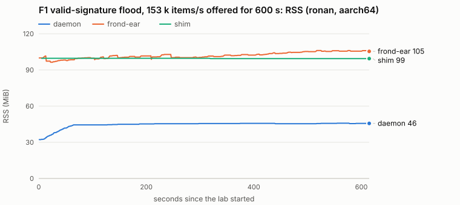
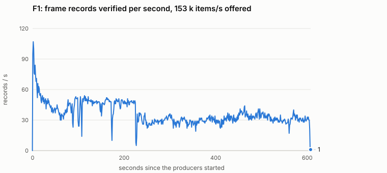
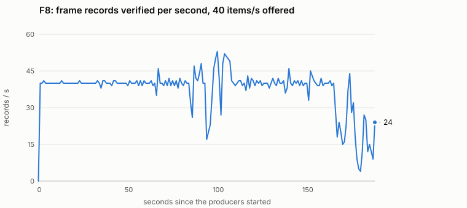
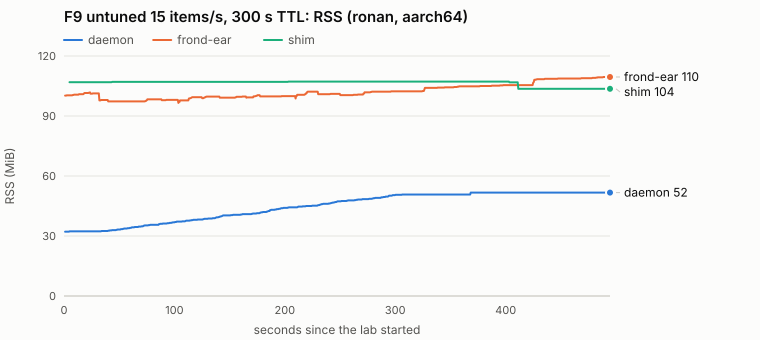

# Step one is measurement: the built canticle path, and the flood acceptance test

**Status:** measurement report for [#168](https://github.com/karmaterminal/binary-canticle/issues/168),
design `docs/design/sense-organ.md` §2.8 (branch `gloss/sense-organ-doc` at `5acceec3`). No design or
component code was changed. Every instance measured here was a throwaway built from source in a scratch
directory, on loopback only; the live daemon, the live `frond-ear.service`, the live stations and the room
were never touched. Raw files are under [`results/`](results/), and the harness is under [`harness/`](harness/).

**Verdict: the §2.8 flood acceptance test FAILS on the built path (ronan, aarch64).** Memory and model
admission stayed bounded. But as a flood grew past what the host daemon processed here, the quiet tuned
stream degraded by degrees (all of it seconds late at about twice that rate, two thirds at 5–9 times, a
sixth at 24 times) until it all but stopped at 60 times and more; and no layer reported the loss (§1).
The cause is the first hop, and it isn't verification.

Headline numbers (ronan, aarch64, every process at `nice -n 19`; they don't carry to silas):

1. **The host daemon took 74–88 new items/s for the first 20 s from an empty state, and about 40/s sustained**
   (chatter, 60 s TTL). That is **this niced, durable-write workload's observed rate on ronan aarch64**, not
   a general daemon ceiling. It held at every stream count (1 to 10 000), payload (64 B to 1 100 B frames)
   and ear count (1 or 4). What held it there is the write-ahead save of the whole state before each new
   item: about 7 ms of fsync plus about 4 µs per live dedup entry. An Ed25519 verify is 41 µs on an X925
   core and 101 µs on an A725 core, and the whole admission parse 58 and 136 µs. Per-batch verify: not
   measurable yet (no batch signatures).
2. **Above that rate the kernel drops datagrams at the daemon's socket, and nothing reports it**: 92 M in
   F1's 10 minutes (the socket's own `drops` counter in `/proc/net/udp`, 99.98 % of the datagrams that
   reached it), with the daemon's health `ok` (no reasons), frond-ear's receive health `ok`, and record
   v1's per-item gap `"unavailable"`. The quiet tuned stream (one item every 10 s from a real station) lost
   all or nearly all of its items during valid-key, real-station, replay and forged floods (0–5 of 18–60
   arrived) — floods of 60× to 4 200× what the daemon processed of them.
3. **Latency**: station send → daemon record 9–15 ms when idle and p50 10–13 ms / p99 17–26 ms at 40
   items/s; send → push 5.1–6.0 s, which is frond-ear's 5 s debounce plus its 1 s poll. Under a 100/s
   flood every quiet item still arrived, 2.5–8 s late.
4. **Admission is bounded**: on the live settings the session gets at most 60 pushes an hour and 5 records
   a push, whatever is offered. A1 offered 12 600 items and pushed 300; A3 offered 11.7 M and pushed 300.
   The §2.8 quiet stream alone (one item every 10 s) reaches that cap after 10 minutes, and the rest of its
   hour expires unpushed without a word to the session (A4).
5. **Memory stayed bounded in every cell**: daemon ≤ 52 MiB, frond-ear ≤ 146 MiB (a garbage-collection
   sawtooth under steady pushing), shim ≤ 110 MiB.

Five findings are written up with reproductions: silent loss at the first hop; repeats of one valid
frame are enough to black out reception; a push can promise "N more records wait for the next push" and
then go silent; untuned streams can fill frond-ear's 4 096-record live set, so tuned items are refused
(5 of 20 lost at only 15 items/s); and the hourly push budget cuts a quiet stream off without a word.

## What was measured, and at which SHAs

| Ref | Value | Notes |
|---|---|---|
| product/base | binary-canticle `origin/main` `08c11127d4e11ed00f307a7006d85581c8674a28` | station, host daemon, codec. The live clone runs `ba980e32`, an ancestor; `wire.py`, `cbor.py`, `ids.py`, `manifest.py`, `listener.py`, `records.py`, `daemon.py`, `station.py` and `runner.py` are byte-identical between the two |
| frond-ear | `origin/main` `7c9bbd3179c50e6ad6870dcb0c74f68d47b4229d` | `src/` and `pnpm-lock.yaml` are identical to the installed `43dab0e5`. Read-only clone; `node_modules` is the same-host install at the same lock |
| lane branch | `codeagent/canticle-step-one-measurement-2` | this report |
| CI | this repository's own `tests.yml` | nothing here is tested by it; the report adds no product code |
| presentation | N/A | not merged by this lane |
| design/proof | `gloss/sense-organ-doc` `5acceec3a6527bbd3bb918cb7e945fc2d904abf1` | §2 read whole; §2.8 is the brief |

Runtimes: Python 3.12.3 with `cryptography` 50.0.1 from `.github/ci/requirements-station.txt` (the live
venv runs 3.12.3 with 50.0.2; there is no Python 3.11 on ronan). The frond-ear daemon ran on the live
unit's node (v26.12.1), and its shim on the live session's node (v26.9.0).

## The machine: ronan, aarch64. These numbers do not carry to silas (x86_64)

| | |
|---|---|
| host / arch | **ronan, aarch64**, kernel `7.0.0-1019-nvidia` |
| CPU | 20 cores, no SMT, **two core types**: 10 × Cortex-X925 up to 3.9 GHz (cpus 5-9, 15-19) and 10 × Cortex-A725 up to 2.8 GHz (cpus 0-4, 10-14). Path processes were not pinned, so the scheduler put them on either type; the isolated microbenchmarks were pinned to one core of each type and are reported per type |
| RAM | 122 GiB |
| disk | ext4 on NVMe (`nvme0n1`, scheduler `none`). Scratch state lived on this same filesystem as the live daemon's `~/.local/state/canticle/daemon`, so a fsync costs what it costs the seat |
| loopback | `lo`, MTU 65 536. `net.core.rmem_default` 212 992 B (the daemon sets no `SO_RCVBUF`), `rmem_max` 4 MiB |
| niceness | every process of this lane ran under `nice -n 19 ionice -c3`, in this session's cgroup (`app.slice/scribe-rez.service`), never in `openclaw-gateway.service`. With the NVMe scheduler at `none`, the kernel does not arbitrate I/O by ionice class, so `-c3` is recorded but had no effect. The daemon under test therefore ran at nice 19 beside nice-0 neighbours (load up to 17 of 20 cores in F1); the part of its per-item cost that is CPU (the JSON rewrite) may run slower than the live, un-niced daemon's. Every rate here is therefore this niced, durable-write workload's observed rate on ronan: a floor for this host, not a forecast, and not a general daemon ceiling |
| neighbours | 🌊's live gateway and an unrelated uid's CI-like node jobs shared the host. The 1-minute load average is in every sampler row (`samples.csv`, column `loadavg1`) and in each table below; it stayed under `nproc` (20) except where a table says otherwise |

**Do not extrapolate.** The two costs behind every rate below are an Ed25519 verify (CPU) and a
durable save (disk). Both differ between ronan's two core types, and both will differ on silas.

## The path, as the live seats configure it (multicast off, unicast)

The live configuration was read for its transport shape only (no keys, no payloads, no key ids):

- host daemon: `canticle daemon --stations ~/.binary-canticle/stations.toml --bind <LAN addr>:9999 --no-multicast --socket $XDG_RUNTIME_DIR/canticle/daemon.sock`; `stations.toml` `[listen] bind = "<LAN addr>:9999"`, `multicast = false`;
- stations: `canticle station … --stream chatter [--stream facts:live-state:900 --stream display:live-state:900] --to <peer>:9999` × 4, unicast, default `--beacon-ms 1000` and budgets (B_station 16 kbit/s, b_stream 4 kbit/s);
- frond-ear: `canticle.source: "host-daemon"`, `hostSocket` unset (so the daemon's default socket), one ear, 5 tune patterns, 2 wake keys, `delivery: {mode: "off", stations: {<3 stations>: "immediate"}}`, every other delivery setting at its default (`debounceMs` 5 000, `maxAgeMs` 30 000, `windowMs` 60 000, `maxItems` 5, `bufferPerStream` 32, `maxPushesPerHour` 60), `limits.maxNotificationChars` 6 000;
- at the time of reading, the live daemon held 23.9 MiB resident (peak 31.6 MiB) and an 875-byte state file, and the live frond-ear 61 MiB (peak 111 MiB).

The lab reproduces that shape on loopback: `canticle daemon --manifest <lab>/fleet.json --bind 127.0.0.1:<port> --no-multicast --socket <lab>/run/canticle/daemon.sock --state-dir <lab>/state/canticle-daemon --health-interval 1`;
real `canticle station … --to 127.0.0.1:<port>` processes; frond-ear `src/cli.ts daemon` with
`source: "host-daemon"`, `hostSocket` set explicitly to the lab socket, and the live delivery shape.
Differences from the seat: loopback instead of the LAN NIC, one `--to` destination instead of four, a
1 s health interval instead of 10 s (so health is visible per second), and a dead loopback port standing
in for Discord (`DISCORD_GATEWAY_URL`, `DISCORD_API_BASE`; the gateway retries on its backoff and never
connects; canticle delivery doesn't depend on it).

```
producer ──UDP──▶ kernel socket buffer ──▶ canticle daemon ──record v1 / unix socket──▶ frond-ear daemon ──ear protocol──▶ shim ──stdio MCP──▶ session
 (station or       (212 992 B; drops       (verify, dedup,                              (RecordConsumer:            (delivery:                (notifications/
  blast.py)         counted only in         write-ahead save,                            live set ≤ 4 096,          tune, wakeKeys,            claude/channel)
                    /proc/net/udp)          fan-out ≤ 16 peers,                          rec_seq gaps)              debounce, caps)
                                            1 024 records each)
```

## 1. The flood acceptance test

> *An unrelated producer floods the tower; memory and model admission stay bounded; the quiet tuned stream
> keeps arriving; loss, lag and gaps are reported honestly. A saturated link with an overwhelmed prince is
> a failed radio.* (design §2.8)

**Setup, every cell.** A fresh lab. One ear (the live seat has one): a frond-ear daemon with the live
delivery shape, `tune: ["quiet:quiet"]`, `wakeKeys: [<quiet key>]`, `delivery: {mode: "off", stations:
{quiet: "immediate"}}`, defaults otherwise, and a fake session on frond-ear's real shim. The **quiet tuned
stream** is a real `canticle station` (`--stream quiet:chatter`, unicast to the daemon) driven through its
control socket with one 64-byte item every 10 s ([`singer.py`](harness/singer.py) `--interval 10`); the
station sends each item at once, then a 3-copy burst at +1, +2 and +4 s, then loops it until its 60 s TTL
runs out. The **flood** is untuned (not in the tune; not on `wakeKeys` either, except in F6, where it shares
the quiet stream's station and key) and comes from a key the manifest
licenses unless the cell says otherwise. The flood producers and the quiet singer run for the cell's
duration, then the lab keeps listening for the drain (8 s for F0, F1 and F9; 60 s or more for the others),
so items the carousel recovers after the flood stops are seen. Commands: `nice -n 19 ionice -c3 python
run_cells.py ../results/<dir> @../results/<dir>/<list>.json`, with F0 and F1 from `flood/cells.json`, F3–F8
from `flood/cells-rest.json`, F1b, F2b, F3b and F9 from `flood2/cells.json`, and F10 and F11 from
`flood3/cells.json` (see *Run history*). Every cell's parameters are in its `result.json`; "4x" or "2x" in a
cell's name is its number of producer processes, not its overload.

**How drops were counted.** Every kernel-drop count in this report is the daemon socket's own `drops`
counter in `/proc/net/udp`, read after the daemon bound and again after the drain, with the difference
reported (`kernel_drops` in each `result.json`; [`mlib.py`](harness/mlib.py) `udp_socket_drops`). The
harness found the socket's row by its local address, the daemon's `127.0.0.1:<port>`, a port the lab
picked free for the daemon alone. It recorded the row's inode once a second (`udp` in each
`timeline.json`): one inode for the whole of every cell (nine in R1, one per daemon run, each at 0 drops
in every sample; a drop in a socket's last second before a SIGKILL would not show). It did not cross-check
that inode against the daemon process's file descriptors. The harness also read
`RcvbufErrors` from `/proc/net/snmp` (`snmp_delta`). That counter is **network-namespace-wide**, shared
with every UDP socket in the namespace (🌊's gateway and other users' jobs included), so it is
namespace-level and not attributed to the socket. No number in this report rests on it, though in every
cell its difference equalled the socket's own count exactly. The share beside each count below is
socket-local: drops ÷ (drops + the datagrams the daemon read, which is the sum of its own `admission`,
`beacon` and `unverified` counters in its last health record). Drops plus reads equal what the producers
sent exactly in A1–A3 and in all 63 ingest cells. In the flood cells with producers they exceed it by
404–1 142, or 1.6–1.9 datagrams/s, which matches the quiet station's own traffic (F0, the quiet station
alone, read 1.8/s; no station-side count was kept). So on this loopback path, datagrams were lost at that
socket and, as far as these counts can show, nowhere else.

| cell | offered | daemon's own rates (per s, from its health) | daemon CPU mean | kernel drops at the daemon's socket, its own `drops` (share of the datagrams that reached the socket) | what the daemon's health said | what frond-ear said | load avg max |
|---|---|---|---|---|---|---|---|
| F0-baseline-quiet-only | none | verified 0.1, duplicate 0.7 | 0.4 % | 0 | `ok`, reasons [], records dropped 0 | `ok` []; delivery {'pushes': 12, 'records_pushed': 12} | 12.0 |
| F1-valid-flood-4x-max | 153,402 valid items/s (190 B) | verified 36.3 | 51.5 % | 92,020,097 (99.98 %) | `ok`, reasons [], records dropped 0 | `ok` []; delivery {'routed_late': 1} | 17.3 |
| F1b-valid-flood-2x-max-then-recovery | 77,377 valid items/s (190 B) | verified 36.8 | 32.0 % | 13,921,301 (99.95 %) | `ok`, reasons [], records dropped 0 | `ok` []; delivery {'pushes': 2, 'records_pushed': 3, 'routed_late': 3, 'off_air_unpushed': 3} | 14.4 |
| F2b-forged-flood-2x-max | 1,006,277 forged items/s (188 B) | verified 0.0, bad_signature 15,991.8 | 81.9 % | 297,085,287 (98.41 %) | `ok`, reasons [], records dropped 0 | `ok` []; delivery {'pushes': 5, 'records_pushed': 7, 'routed_late': 1, 'off_air_unpushed': 1} | 12.3 |
| F3-unknown-key-flood-2x-max | 73,062 unknown items/s (190 B) | verified 0.1, duplicate 0.7, unknown_key 72,789.5 | 51.0 % | 79,866 (0.36 %) | `ok`, reasons [], records dropped 0 | `ok` []; delivery {'pushes': 30, 'records_pushed': 30} | 14.4 |
| F3b-unknown-key-flood-2x-max-fixed-frame | 1,001,072 unknown-fixed items/s (188 B) | verified 0.1, duplicate 0.1, unknown_key 205,209.9 | 81.8 % | 238,745,107 (79.50 %) | `ok`, reasons [], records dropped 0 | `ok` []; delivery {'pushes': 16, 'records_pushed': 21, 'routed_late': 5, 'off_air_unpushed': 5} | 10.0 |
| F4-replay-flood-2x-max | 1,090,096 dup items/s (188 B) | verified 2.0, duplicate 13,941.1 | 79.8 % | 322,844,021 (98.72 %) | `ok`, reasons [], records dropped 0 | `ok` []; delivery {'pushes': 2, 'records_pushed': 3, 'routed_late': 3, 'off_air_unpushed': 3} | 11.8 |
| F5-real-station-flood | real station, 5,250 sings/s | verified 41.3 | 48.0 % | 1,563,613 (99.17 %) | `ok`, reasons [], records dropped 0 | `ok` []; delivery {'routed_late': 4, 'off_air_unpushed': 4, 'pushes': 1, 'records_pushed': 2} | 15.5 |
| F6-quiet-inside-flood-station | real station, 5,801 sings/s | verified 38.8 | 45.0 % | 1,729,507 (99.30 %) | `ok`, reasons [], records dropped 0 | `ok` []; delivery {'routed_late': 4, 'off_air_unpushed': 4, 'pushes': 2, 'records_pushed': 2} | 13.6 |
| F7-valid-flood-100ps | 100 valid items/s (188 B) | verified 45.8, duplicate 0.3 | 45.5 % | 9,640 (52.38 %) | `ok`, reasons [], records dropped 0 | `ok` []; delivery {'pushes': 18, 'records_pushed': 18} | 16.6 |
| F8-valid-flood-40ps | 40 valid items/s (188 B) | verified 38.9, duplicate 0.7 | 35.6 % | 120 (1.58 %) | `ok`, reasons [], records dropped 0 | `ok` []; delivery {'pushes': 18, 'records_pushed': 18} | 12.2 |
| F9-untuned-long-ttl-15ps | 15 valid items/s (188 B) | verified 15.1, duplicate 0.8 | 31.0 % | 0 | `ok`, reasons [], records dropped 0 | `ok` [] {'live_overflow': 414}; delivery {'pushes': 43, 'records_pushed': 43} | 8.2 |
| F10-valid-flood-400ps | 400 valid items/s (190 B) | verified 46.4, duplicate 0.0, expired 0.0 | 42.7 % | 63,591 (87.82 %) | `ok`, reasons [], records dropped 0 | `ok` []; delivery {'pushes': 11, 'records_pushed': 13, 'routed_late': 2, 'off_air_unpushed': 2} | 7.9 |
| F11-valid-flood-1000ps | 1,000 valid items/s (190 B) | verified 41.3 | 37.1 % | 172,488 (95.61 %) | `ok`, reasons [], records dropped 0 | `ok` []; delivery {'pushes': 4, 'records_pushed': 5, 'routed_late': 3, 'off_air_unpushed': 3} | 6.7 |

| cell | overload | quiet items sung while the flood ran | of those, reached the daemon during / after the flood | of those, pushed during / after the flood | pushes in all (max records per push) | daemon RSS max (MiB) | frond-ear RSS start → max (MiB) | shim RSS max (MiB) |
|---|---|---|---|---|---|---|---|---|
| F0-baseline-quiet-only | – | 12 (whole run) | 12 in all (no per-item timing in this cell) | 12 | 12 (1) | 32 | 100 → 103 | 101 |
| F1-valid-flood-4x-max | ≈ 4 200× | 60 (whole run) | 3 in all (no per-item timing in this cell) | 0 | 0 (0) | 46 | 100 → 106 | 100 |
| F1b-valid-flood-2x-max-then-recovery | ≈ 2 100× | 18 | 1 / 5 | 1 / 2 | 2 (2) | 44 | 102 → 103 | 101 |
| F2b-forged-flood-2x-max | ≈ 63× | 30 | 5 / 3 | 4 / 3 | 5 (3) | 32 | 106 → 110 | 99 |
| F3-unknown-key-flood-2x-max | ≈ 1× | 30 | 30 / 0 | 30 / 0 | 30 (1) | 32 | 108 → 112 | 106 |
| F3b-unknown-key-flood-2x-max-fixed-frame | ≈ 4.9× | 30 | 23 / 3 | 19 / 2 | 16 (2) | 32 | 100 → 104 | 101 |
| F4-replay-flood-2x-max | ≈ 78× | 30 | 1 / 5 | 1 / 2 | 2 (2) | 32 | 101 → 103 | 100 |
| F5-real-station-flood | ≈ 130× | 30 | 1 / 5 | 0 / 2 | 1 (2) | 47 | 101 → 103 | 108 |
| F6-quiet-inside-flood-station | ≈ 150× | 30 | 2 / 4 | 0 / 2 | 2 (1) | 47 | 99 → 101 | 100 |
| F7-valid-flood-100ps | ≈ 2.2× | 18 | 18 / 0 | 17 / 1 | 18 (1) | 46 | 101 → 104 | 96 |
| F8-valid-flood-40ps | ≈ 1× | 18 | 18 / 0 | 17 / 1 | 18 (1) | 42 | 104 → 107 | 108 |
| F9-untuned-long-ttl-15ps | < 1× (0 socket drops) | 48 | 48 / 0 | 43 / 0 | 43 (1) | 52 | 100 → 110 | 107 |
| F10-valid-flood-400ps | ≈ 8.6× | 18 | 13 / 2 | 12 / 1 | 11 (2) | 48 | 101 → 104 | 100 |
| F11-valid-flood-1000ps | ≈ 24× | 18 | 3 / 5 | 3 / 2 | 4 (2) | 46 | 99 → 102 | 102 |

Overload is what the flood offered per second divided by what the daemon processed of that kind per second
(its own health counters: verified, duplicate, bad_signature or unknown_key), to two significant figures;
where the daemon's socket dropped nothing (F9), the daemon read the whole flood, and the cell says < 1×.
F0 and F1 have no per-item timing (it was added to the collector after them; see *Run history*). F1's "3
in all" were nonetheless all after the flood: the probe stopped listening at about 609 s, so of the three
latencies (15.9, 23.5, 43.5 s) the item sung at 592 s can only be the 15.9 s one, which leaves the other
two arriving at 605.6 s; the flood stopped at 600 s. Every cell's parameters, per-item quiet timing
(`quiet_items`), the daemon's health records, frond-ear's status timeline and the pushes are in its
directory.









The CSV behind each chart is that cell's `samples.csv` (RSS and CPU every 0.5 s, with the load average)
or `result.json` (`probe_verified_per_s`).

**PASS criteria, one by one:**

| criterion | verdict | evidence |
|---|---|---|
| the quiet tuned stream keeps arriving | **FAIL** | When the flood offered about 60 times or more what the daemon processed of it (overload, offered ÷ processed per second of that kind: F1 ≈ 4 200×, F1b ≈ 2 100×, F6 ≈ 150×, F5 ≈ 130×, F4 ≈ 78×, F2b ≈ 63×), the quiet stream all but stopped while it ran. Valid-key flood: 0 of 60 arrived while it ran (F1; 3 arrived in the 8 s after it stopped, one of them already 43 s old and routed late, and none was pushed before the cell ended), 1 of 18 (F1b). Real station flooded through its own control socket: 1 of 30 (F5); the quiet stream on that same station: 2 of 30, neither pushed (F6). Repeats of one valid frame: 1 of 30 (F4). Forged signatures: 5 of 30 (F2b). Unknown key at 1 M datagrams/s: 23 of 30 arrived, 19 pushed (F3b). A flood the daemon could keep up with still cost quiet items at the ear once it filled frond-ear's live set: 5 of the 20 sung after that point (F9, Finding 4). Between those it degraded by degrees: at about 5× (F3b, above), 9× (F10, valid items at 400/s: 12 of 18 pushed while it ran, the rest lost or too late) and 24× (F11 at 1 000/s: 3 of 18). At 1–2× it survived: unknown key at 73 k/s (F3, 30 of 30, within 71 ms), a valid flood at 40/s (F8), and at 100/s (F7, ≈ 2.2×), where the daemon processed 46/s and its socket dropped 9 640 datagrams (its own `drops`, 52 % of what reached it), yet every quiet item arrived, up to 8.2 s late |
| memory stays bounded | **PASS**, for these durations | No process grew without bound in any flood cell: daemon at most 52 MiB, frond-ear at most 110 MiB, shim at most 108 MiB (tables and traces above). The daemon grows with its dedup set, about 4.5 KB per live entry (32 → 52 MiB in F9 at about 4 500 entries), so its per-key quota (100 000 / keys in the manifest) would allow about 450 MB with one key; no cell got near it, and both it and frond-ear were still at their maximum at F9's last sample. frond-ear rose 100 → 106 MiB over F1's 10 minutes and 100 → 110 MiB in F9 while its live set filled to its 4 096-record bound; under steady pushing (§4) it swung between about 100 and 146 MiB with garbage collection |
| model admission stays bounded | **PASS** | The untuned flood never reached the session in any cell: it isn't tuned (and, except in F6, isn't on `wakeKeys`). The session got at most one push per quiet item, at most 3 records a push |
| the push rate stays under the cap | **PASS** in every flood cell, but see §4 | The most pushes in any flood cell was 43 in 480 s (F9), under `maxPushesPerHour` 60. The quiet stream alone (360 items an hour) is six times that cap: on the live settings it reached the cap at 597 s with no flood at all, and the rest of its items expired unpushed (§4, cell A4; Finding 5) |
| loss, lag and gaps for the flood are reported, not silent | **FAIL** | In every cell the daemon's health said `ok` with no reasons, and frond-ear's receive health said `ok`. Kernel drops at the daemon's socket (its own `drops`: from 120 in F8 to 323 M in F4, and 1.6 M to 323 M in the cells where the quiet stream all but stopped) appear in no record, status or push. A forged or unknown-key flood is visible in the daemon's counters (`bad_signature`, `unknown_key`, and the D34 key-id table naming the impersonated key ids), but nothing reports what it cost. A valid-key flood looks like ordinary traffic. For what did arrive, lag is honest per record (`age=33s` in the push), but in `immediate` pushes (the live setting) a hole in the quiet stream shows only as a jump in item numbers (`item=…/3`, then `…/17`; digest reports would say `N seqs skipped`), and records promised to "the next push" can expire with no push to say so (Findings 3 and 5) |

**Verdict: FAIL.** The prince was not overwhelmed (admission stayed bounded), but the quiet tuned stream
all but stopped arriving under floods of 60× or more what the daemon processed, lost most items at 24×
and about a third at 5–9×, arrived seconds late at about 2×, and nothing reported the loss.

## 2. Verify cost, per item (and why it isn't what held the rate)

Method: [`harness/verify_bench.py`](harness/verify_bench.py), one process pinned with `sched_setaffinity`
to cpu 19 (Cortex-X925) and then cpu 14 (Cortex-A725), 3 000 frames per step (300 for sign, 1 000 for the
duplicate, 250 per step of the save curve), `perf_counter_ns` around
each call; frames are chatter ITEMs signed by a throwaway key, bodies of 64 B, 512 B and the largest that
fits the frame. Raw: [`results/verify/verify.json`](results/verify/verify.json). Command:
`nice -n 19 ionice -c3 python verify_bench.py ../results/verify/verify.json`.

**Batches: not measurable yet.** Frame v2 carries one Ed25519 signature per datagram and the daemon
verifies one per datagram; batch roots and membership proofs are unbuilt (design §2.8).

**On payload size.** The workorder's "1 200 B" is the datagram cap (`MAX_DATAGRAM`). A frame may be at
most 1 100 B (`MAX_FRAME`, RFC §9), so the largest payload is a body of about 975 B in a 1 098 B frame.
That is what "max" means everywhere in this report.

| step (ronan, aarch64) | frame | X925 mean µs (p99) | X925 per core /s | A725 mean µs (p99) | A725 per core /s |
|---|---|---|---|---|---|
| sign (what the station pays, for scale) | 186 B | 23.1 (25.6) | 43 206 | 52.0 (57.3) | 19 250 |
| sign | 1 098 B | 24.8 (26.7) | 40 400 | 54.8 (64.5) | 18 264 |
| Ed25519 verify alone | 186 B | 40.5 (42.8) | 24 722 | 101.4 (105.5) | 9 866 |
| Ed25519 verify alone | 635 B | 40.8 (43.0) | 24 518 | 101.8 (105.8) | 9 819 |
| Ed25519 verify alone | 1 098 B | 41.1 (43.2) | 24 344 | 102.3 (106.1) | 9 775 |
| CBOR decode + re-encode (the determinism check) | 1 098 B | 12.2 (14.0) | 82 302 | 23.6 (26.8) | 42 417 |
| whole admission parse, `wire.parse` | 186 B | 57.6 (60.0) | 17 367 | 136.0 (144.6) | 7 354 |
| whole admission parse, `wire.parse` | 1 098 B | 58.9 (61.2) | 16 993 | 138.4 (148.3) | 7 226 |
| `Listener.hear`, new item, no state file | 186 B | 65.2 (81.1) | 15 330 | 155.0 (189.3) | 6 453 |
| `Listener.hear`, duplicate (a carousel repeat) | 186 B | 61.7 (64.7) | 16 196 | 146.1 (160.0) | 6 843 |

Verify is flat in payload size: SHA-512 over 1 KB costs nothing next to the curve arithmetic. An A725
core is 1.9–2.5 × slower than an X925 core at every CPU-bound step (1.9 × for CBOR, 2.2 × for sign, 2.3–2.5 ×
for verify and parse); the save at 0 entries, which is mostly fsync, is the same on both.

**What a new item actually costs the daemon.** The daemon's `Receptor.hear` is write-ahead (RFC §14.18.2;
`records.py` `Receptor._batch`): before it emits a new item's record, it saves the whole safety state,
which is a JSON document of every live dedup entry and every surfaced tuple, written to a temporary file,
fsynced, renamed and the directory fsynced. The same call with its state on the lab disk, then on
`/dev/shm` (where fsync is free), as the dedup set grows:

| live dedup entries before | state file after | X925, ext4/NVMe: ms per new item mean (p99) | X925, tmpfs | A725, ext4/NVMe | A725, tmpfs |
|---|---|---|---|---|---|
| 0 | 56 KB | 8.2 (26.2) | 0.6 | 8.1 (12.3) | 1.2 |
| 500 | 168 KB | 26.2 (194.1) | 2.4 | 11.9 (17.1) | 5.0 |
| 1 000 | 280 KB | 12.5 (20.9) | 4.3 | 16.2 (22.4) | 9.1 |
| 2 000 | 506 KB | 16.1 (20.4) | 8.2 | 26.9 (88.2) | 17.2 |
| 3 000 | 732 KB | 20.7 (27.8) | 12.2 | 40.6 (100.8) | 24.8 |
| 3 500 | 845 KB | 22.7 (30.5) | 14.2 | 44.5 (57.8) | 29.6 |

(The 500-entry X925 step on disk caught one long stall: a 194 ms p99 and a 26 ms mean. The steps either
side of it are 8 and 12 ms.)

A durable save of a tiny file alone (`atomic_write_json`, two fsyncs) took 7.4 ms mean, 13.8 ms p99,
500 samples. So a new item costs about **7 ms of fsync plus about 4 µs per live dedup entry on an X925
core (8 µs on an A725)**, about 226 B of state per entry, while a duplicate costs only its verify
(62.6 µs X925, 150.9 µs A725, no save). Verify is under 1 % of a new item's cost.

A dedup entry lives for the item's local expiry plus 5 s, so at a steady rate *r* of new chatter items
(TTL 60 s) the daemon holds about 65·*r* entries, and the predicted rate is where *r* × cost(65·*r*) = 1 s.
On an X925 core that is about 50 items/s, on an A725 core about 35/s, for every stream and every payload
size. For live-state items at the 900 s TTL the live `facts` and `display` streams use, the same arithmetic
gives about 16/s on an X925 core. At the per-key quota of 100 000 entries (one key in the manifest), a
save would be about 22 MB of JSON and over 400 ms. These are predictions for this durable-write workload
on ronan's two core types, from the isolated costs, not a general daemon ceiling; the in-path numbers
below are what the built path did.

## 3. Ingest and fan-out through the daemon

**Method.** 5 stream counts (1, 10, 100, 1 000, 10 000 logical streams, round-robin, all on one producer
key so that only the stream count changes) × 3 payloads (64 B, 512 B, max) × 1 and 4 ears (each ear a
frond-ear daemon with a fake session; the probe tap is one more binding, so 2 or 5 connections on the
daemon socket). Each combination ran twice, each time in a fresh lab: **saturated** (one producer flat
out, 20 s) for the observed rate, and **40 items/s** (30 s, below that rate on fresh state) for latency.
Each ear tuned the producer's first stream, with the producer on `wakeKeys` and `immediate` delivery,
so pushes happened on the live settings. Then three cells tuned every stream (100, 1 000 and 10 000
patterns) to show what a large tune costs frond-ear. Latency is CLOCK_MONOTONIC from the producer's
`sendto` to the probe's receipt of the item's `frame` record (send→record), and to the fake session's
read of the push carrying it (send→push). CPU% is of one core; RSS is the maximum over the cell. Raw:
[`results/ingest/`](results/ingest/); command:
`nice -n 19 ionice -c3 python run_cells.py ../results/ingest @../results/ingest/cells.json`.

| ears | streams | payload (frame B) | saturated: offered/s → verified/s, kernel drops (the daemon socket's own `drops`) | 40/s: send→record p50 / p99 ms | 40/s: send→push p50 / p99 ms (n) | daemon CPU % sat / 40 | daemon RSS MiB | frond-ear CPU % (mean of ears) / RSS MiB (max of ears), saturated cell | shim RSS MiB | probe gaps sat / 40 | frond-ear loss counts: receive side (all ears, both cells); delivery (ear0, 40/s cell) |
|---|---|---|---|---|---|---|---|---|---|---|---|
| 1 | 1 | 64 (190) | 38,729 → 79.9, 772,785 | 11.4 / 20.8 | 778 / 6,842 (35) | 32.0 / 13.7 | 39 | 1.4 / 120 | 100 | 0 / 0 | receive none; 40/s delivery: pushed 35, dropped 1143, late 0 |
| 1 | 1 | 512 (639) | 37,365 → 80.5, 745,531 | 10.7 / 17.4 | 776 / 6,848 (35) | 32.0 / 13.1 | 40 | 1.5 / 117 | 100 | 0 / 0 | receive none; 40/s delivery: pushed 35, dropped 1143, late 0 |
| 1 | 1 | max (1100) | 36,084 → 79.6, 720,012 | 11.3 / 18.2 | 793 / 6,845 (21) | 30.9 / 13.0 | 40 | 1.4 / 122 | 99 | 0 / 0 | receive none; 40/s delivery: pushed 21, dropped 1153, late 0 |
| 1 | 10 | 64 (190) | 37,777 → 77.9, 753,798 | 11.1 / 20.2 | 7,526 / 12,781 (35) | 31.3 / 12.9 | 38 | 1.2 / 110 | 101 | 0 / 0 | receive none; 40/s delivery: pushed 35, dropped 63, late 0 |
| 1 | 10 | 512 (639) | 36,572 → 77.5, 729,768 | 11.1 / 18.8 | 7,535 / 12,755 (35) | 31.0 / 12.4 | 39 | 1.2 / 103 | 98 | 0 / 0 | receive none; 40/s delivery: pushed 35, dropped 63, late 0 |
| 1 | 10 | max (1100) | 36,529 → 79.2, 728,932 | 11.2 / 19.6 | 7,751 / 13,312 (21) | 29.2 / 13.2 | 40 | 1.2 / 103 | 99 | 0 / 0 | receive none; 40/s delivery: pushed 21, dropped 73, late 0 |
| 1 | 100 | 64 (188) | 38,842 → 80.5, 775,051 | 10.9 / 17.0 | 3,257 / 6,013 (12) | 33.3 / 11.7 | 38 | 1.2 / 108 | 101 | 0 / 0 | receive none; 40/s delivery: pushed 12, dropped 0, late 0 |
| 1 | 100 | 512 (637) | 37,457 → 80.2, 747,378 | 11.5 / 18.3 | 3,241 / 5,997 (12) | 33.9 / 13.7 | 40 | 1.1 / 101 | 101 | 0 / 0 | receive none; 40/s delivery: pushed 12, dropped 0, late 0 |
| 1 | 100 | max (1098) | 36,476 → 79.0, 727,859 | 11.3 / 19.1 | 3,045 / 5,958 (12) | 29.4 / 13.4 | 41 | 1.2 / 103 | 103 | 0 / 0 | receive none; 40/s delivery: pushed 12, dropped 0, late 0 |
| 1 | 1,000 | 64 (188) | 39,152 → 75.8, 781,349 | 11.0 / 18.3 | 6,012 / 6,031 (2) | 30.1 / 13.2 | 38 | 1.1 / 101 | 104 | 0 / 0 | receive none; 40/s delivery: pushed 2, dropped 0, late 0 |
| 1 | 1,000 | 512 (637) | 37,667 → 88.4, 751,450 | 10.7 / 18.1 | 5,998 / 6,015 (2) | 28.7 / 11.9 | 41 | 1.1 / 103 | 101 | 0 / 0 | receive none; 40/s delivery: pushed 2, dropped 0, late 0 |
| 1 | 1,000 | max (1098) | 35,605 → 75.0, 710,523 | 11.1 / 22.1 | 5,971 / 5,984 (2) | 27.5 / 13.1 | 40 | 1.0 / 108 | 100 | 0 / 0 | receive none; 40/s delivery: pushed 2, dropped 0, late 0 |
| 1 | 10,000 | 64 (187) | 38,606 → 84.9, 770,217 | 11.0 / 19.1 | 5,972 / 5,972 (1) | 33.0 / 13.3 | 40 | 1.1 / 102 | 103 | 0 / 0 | receive none; 40/s delivery: pushed 1, dropped 0, late 0 |
| 1 | 10,000 | 512 (636) | 37,419 → 86.2, 746,495 | 10.6 / 16.9 | 5,984 / 5,984 (1) | 31.8 / 13.3 | 41 | 1.2 / 109 | 99 | 0 / 0 | receive none; 40/s delivery: pushed 1, dropped 0, late 0 |
| 1 | 10,000 | max (1097) | 36,385 → 85.0, 725,922 | 10.7 / 18.5 | 5,979 / 5,979 (1) | 30.1 / 13.8 | 42 | 1.1 / 110 | 99 | 0 / 0 | receive none; 40/s delivery: pushed 1, dropped 0, late 0 |
| 4 | 1 | 64 (190) | 39,028 → 77.5, 778,824 | 10.3 / 16.8 | 782 / 6,833 (140) | 29.2 / 12.3 | 38 | 1.5 / 115 | 107 | 0 / 0 | receive none; 40/s delivery: pushed 35, dropped 1143, late 0 |
| 4 | 1 | 512 (639) | 37,283 → 77.2, 743,981 | 10.7 / 18.9 | 783 / 6,774 (140) | 27.5 / 12.4 | 39 | 1.3 / 119 | 109 | 0 / 0 | receive none; 40/s delivery: pushed 35, dropped 1143, late 0 |
| 4 | 1 | max (1100) | 36,267 → 82.0, 723,619 | 11.3 / 22.1 | 800 / 6,877 (84) | 29.7 / 13.5 | 41 | 1.5 / 119 | 106 | 0 / 0 | receive none; 40/s delivery: pushed 21, dropped 1153, late 0 |
| 4 | 10 | 64 (190) | 38,627 → 75.4, 770,853 | 12.1 / 21.9 | 7,529 / 12,707 (140) | 29.6 / 13.2 | 38 | 1.4 / 109 | 103 | 0 / 0 | receive none; 40/s delivery: pushed 35, dropped 63, late 0 |
| 4 | 10 | 512 (639) | 37,348 → 77.3, 745,287 | 11.7 / 20.1 | 7,538 / 12,752 (140) | 29.1 / 13.5 | 40 | 1.2 / 107 | 108 | 0 / 0 | receive none; 40/s delivery: pushed 35, dropped 63, late 0 |
| 4 | 10 | max (1100) | 36,159 → 77.5, 721,552 | 11.5 / 26.3 | 7,753 / 13,352 (84) | 28.8 / 13.3 | 41 | 1.4 / 108 | 107 | 0 / 0 | receive none; 40/s delivery: pushed 21, dropped 73, late 0 |
| 4 | 100 | 64 (188) | 39,074 → 74.3, 779,790 | 11.1 / 18.0 | 3,026 / 5,986 (48) | 30.2 / 13.3 | 38 | 1.4 / 109 | 102 | 0 / 0 | receive none; 40/s delivery: pushed 12, dropped 0, late 0 |
| 4 | 100 | 512 (637) | 37,513 → 79.2, 748,527 | 11.4 / 20.9 | 3,122 / 6,030 (48) | 29.4 / 13.0 | 39 | 1.4 / 109 | 107 | 0 / 0 | receive none; 40/s delivery: pushed 12, dropped 0, late 0 |
| 4 | 100 | max (1098) | 36,462 → 85.8, 727,444 | 10.3 / 19.0 | 3,055 / 6,027 (48) | 28.7 / 12.2 | 42 | 1.3 / 111 | 101 | 0 / 0 | receive none; 40/s delivery: pushed 12, dropped 0, late 0 |
| 4 | 1,000 | 64 (188) | 38,515 → 86.8, 768,397 | 10.6 / 19.9 | 5,685 / 6,017 (8) | 31.5 / 13.1 | 39 | 1.2 / 110 | 108 | 0 / 0 | receive none; 40/s delivery: pushed 2, dropped 0, late 0 |
| 4 | 1,000 | 512 (637) | 37,095 → 75.8, 740,224 | 11.1 / 19.4 | 5,751 / 5,990 (8) | 29.2 / 13.2 | 40 | 1.3 / 104 | 107 | 0 / 0 | receive none; 40/s delivery: pushed 2, dropped 0, late 0 |
| 4 | 1,000 | max (1098) | 36,314 → 78.2, 724,634 | 12.7 / 22.8 | 5,680 / 6,017 (8) | 30.6 / 13.4 | 41 | 1.2 / 103 | 108 | 0 / 0 | receive none; 40/s delivery: pushed 2, dropped 0, late 0 |
| 4 | 10,000 | 64 (187) | 38,971 → 81.0, 777,629 | 11.0 / 16.7 | 5,535 / 5,978 (4) | 30.7 / 12.2 | 40 | 1.1 / 101 | 109 | 0 / 0 | receive none; 40/s delivery: pushed 1, dropped 0, late 0 |
| 4 | 10,000 | 512 (636) | 37,911 → 85.5, 756,364 | 10.5 / 18.7 | 5,538 / 5,995 (4) | 29.6 / 11.9 | 41 | 1.0 / 110 | 107 | 0 / 0 | receive none; 40/s delivery: pushed 1, dropped 0, late 0 |
| 4 | 10,000 | max (1097) | 36,240 → 80.5, 723,092 | 10.8 / 18.4 | 5,809 / 5,972 (4) | 30.6 / 12.6 | 42 | 1.2 / 110 | 106 | 0 / 0 | receive none; 40/s delivery: pushed 1, dropped 0, late 0 |

**What this says.**

- **The daemon sets the rate, and nothing else in the matrix moves it.** Over 20 s from fresh state,
  one flat-out producer got 74–88 items/s verified, at 1 or 10 000 streams, at 64 B or 1 100 B, with 1 or
  4 ears. That is this niced, durable-write workload's observed rate on ronan aarch64, not a general
  daemon ceiling. The daemon's socket dropped the other 99.75–99.79 % of what was sent (its own `drops`
  ÷ the producer's sends; in every cell, drops plus the datagrams the daemon read equal the sends
  exactly). Stream count changes nothing because
  the daemon keeps no per-stream queue; payload changes nothing because verify is flat in size and the save writes dedup
  rows, not bodies. Four ears add four record connections, which at these rates cost the daemon nothing
  measurable (0 gaps on every connection: no binding ever fell 1 024 records behind).
- **At 40 items/s on fresh state, send→record is 10–13 ms at p50 and 17–26 ms at p99** in every cell:
  that is the save, not the network (loopback) or verify (0.06 ms). Over a longer run the same rate stops
  fitting (F8, §1). Saturated, latency is whatever the socket buffer holds: 0.8–1.1 s at 1 100 B frames,
  1.8–3.1 s at 190 B ones (p50 of the 5–12 sampled items that survived in each cell), because the fixed
  212 992-byte buffer holds fewer big datagrams. Same drops.
- **Send→push is set by frond-ear's delivery policy, not the path.** One quiet item: 5.1–6.0 s (the 5 s
  debounce plus the 1 s poll; F0). A busy tuned stream: each push carries at most 5 records (3 at 1 100 B,
  the 6 000-character limit), at most one push per debounce, and each stream holds 32 waiting records, so
  at 40/s on one stream the push carries the newest records (p50 0.8 s) and the rest are dropped from the
  buffer (1 143 in 30 s) and said so in the push footer. Spread over 10 streams, records wait longer (p50
  7.5 s).
- **frond-ear and the shim are not the bottleneck at these rates:** about 1 % of a core and 100–122 MiB
  for frond-ear, 98–109 MiB for the shim, in every cell.

**A large tune.** Every stream of the producer tuned (one `station:stream` pattern each), 40 items/s:

| tuned streams (all of the producer's) | offered/s | verified/s | send→push p50 / p99 ms (n) | pushes (records) | frond-ear CPU % mean / max | frond-ear RSS MiB | delivery counts |
|---|---|---|---|---|---|---|---|
| 100 | 40.0 | 40.0 | 15,990 / 28,531 (35) | 7 (35) | 1.2 / 6.0 | 116 | {"pushes": 7, "records_pushed": 35, "routed_late": 270} |
| 1,000 | 40.0 | 40.0 | 10,804 / 25,730 (35) | 7 (35) | 2.1 / 10.0 | 133 | {"pushes": 7, "records_pushed": 35, "routed_late": 279} |
| 10,000 | 40.0 | 40.0 | 20,713 / 30,019 (35) | 7 (35) | 2.1 / 8.0 | 134 | {"pushes": 7, "records_pushed": 35, "routed_late": 267} |

frond-ear matches each live record against the tune on each 1 s poll, stopping at the first pattern that
fits. Here the 1 200 or so live records all matched within the first 1 200 patterns (the tune lists the
streams in the producer's round-robin order), so the 1 000- and 10 000-pattern cells did about the same
work: 2 % of a core. What a long tune costs against untuned records, which scan every pattern, was not
measured. The push path is what saturates: 5 records per 5 s cannot carry 40 records/s, so records age past `maxAgeMs` and are routed late (about 270 in 30 s), and send→push grows
to 11–21 s at p50.

## 4. Admission bound: what reaches the session under load, on the live settings

**Method.** frond-ear's real settings as the live seat runs them: `immediate` per station, `debounceMs`
5 000, `maxAgeMs` 30 000, `maxItems` 5, `bufferPerStream` 32, `maxPushesPerHour` 60,
`maxNotificationChars` 6 000. A producer on `wakeKeys` sings into one tuned stream: A1 at 30 items/s for
7 minutes (under the daemon's observed rate here, so every item reaches the ear; its socket dropped none),
A2 the same with `digest` (the other mode the config allows, `windowMs` 60 000), A3 flat out for 5 minutes
(the daemon saturated; its socket dropped 11 673 865 datagrams, 99.87 % of what reached it). A4
is the §2.8 quiet stream alone, one item every 10 s for 12 minutes, with no flood. Pushes and their
records are counted as the fake session read them. Raw: [`results/admission/`](results/admission/);
command: `nice -n 19 ionice -c3 python run_cells.py ../results/admission @../results/admission/cells.json`.

| cell | duration s | offered items | reached the ear (verified records) | pushes | records pushed | max records/push | pushes/hour cap | held at end | delivery counts |
|---|---|---|---|---|---|---|---|---|---|
| A1-immediate-live-settings-30ps | 420 | 12,600 | 12,600 | 60 | 300 | 5 | 60 | push_budget | {"dropped": 12268, "pushes": 60, "records_pushed": 300} |
| A2-digest-30ps | 300 | 9,000 | 9,000 | 5 | 25 | 5 | 60 | None | {"dropped": 8948, "reports": 5, "records_pushed": 25} |
| A3-immediate-saturated-max | 300 | 11,688,704 | 14,839 | 60 | 300 | 5 | 60 | None | {"dropped": 14507, "pushes": 60, "records_pushed": 300} |
| A4-quiet-only-live-settings-12min | 720 | 0 | 72 | 60 | 60 | 1 | 60 | push_budget | {"pushes": 60, "records_pushed": 60, "routed_late": 12, "off_air_unpushed": 9} |

(A4's producer is the quiet station itself: 72 items sung, all 72 verified.)

- **The bound holds whatever is offered.** 12 600 items (A1) and 11.7 M items (A3, with the daemon
  saturated) both became exactly 60 pushes of at most 5 records: 300 records an hour at most, one push per
  `debounceMs`. Digest (A2) sent one report per `windowMs`, 5 records each. Everything else was dropped
  from the 32-record per-stream buffer and said so in the push footer (`prod:s00000: 146 dropped from a
  full buffer.`; in digest, `5 new records (items …/1800 to …/1804), 1799 dropped from a full buffer:`).
- **When the hour's 60 pushes are spent, the ear goes quiet without saying so.** A1's last push, at 302 s,
  ended `(27 more records wait for the next push.)`; nothing was pushed for the rest of the run, and only
  `ear_status` showed `held: "push_budget"`.
- **The §2.8 quiet stream alone reaches that cap.** A4, one item every 10 s and no flood: 60 items were
  pushed, one per push, the last at 597 s. The 12 sung after that were never pushed: 9 went off air and 3
  were still waiting when the cell ended. The session wasn't told. On the live settings a stream of one
  item every 10 s is heard for 10 minutes in each hour (Finding 5).

## 5. Reconnect storm

**Method.** [`harness/scenario_reconnect.py`](harness/scenario_reconnect.py). Under load (a producer at
30 items/s on one tuned, allowlisted stream with `immediate` delivery, plus the quiet station), four ears
and the probe, so every daemon restart is five bindings reconnecting at once, each asking for a join
snapshot. Restarts, in seconds after the load starts: SIGKILL the daemon at 30 and restart it at 33
(same state directory); SIGTERM it at 70 (it sends `bye`) and restart at 72; SIGKILL frond-ear `ear0` at
110 and restart it at 113 (same database; its shim reconnects by itself); a storm of five daemon SIGKILLs
4 s apart from 150, each restarted 1 s later; at 200, SIGKILL the daemon and all four frond-ears at once,
all restarted at 203; the load ends at 260. frond-ear's status was read every second. Raw:
[`results/reconnect/`](results/reconnect/), with the per-restart analysis from
[`harness/reconnect_report.py`](harness/reconnect_report.py) in `reconnect-analysis.json`.

| stop | at s | restarted at s | the probe saw the new run at s (its outage) | items the producer sent while no daemon ran | of those, reached a daemon |
|---|---|---|---|---|---|
| kill_daemon | 30 | 33 | 37.02 (7.02 s) | 90 | 0 |
| term_daemon | 70 | 72 | 73.16 (3.16 s) | 60 | 2 |
| kill_daemon | 150 | 151 | 153.1 (3.1 s) | 30 | 0 |
| kill_daemon | 154 | 155 | 157.16 (3.16 s) | 30 | 0 |
| kill_daemon | 158 | 159 | 161.03 (3.03 s) | 30 | 0 |
| kill_daemon | 162 | 163 | 165.2 (3.2 s) | 30 | 0 |
| kill_daemon | 166 | 167 | 169.15 (3.15 s) | 30 | 0 |
| kill_all | 200 | 203 | 207.07 (7.07 s) | 90 | 1 |

- **Catch-up.** frond-ear reconnects on a 1 s·2ⁿ backoff and asks for a join snapshot. After each daemon
  restart the four ears were `connected` and `ok` again 1–3 s after the restart (ear status read once a
  second), each with a complete join snapshot of 4–75 frames. Once in the storm an ear's retry landed on the
  next kill and it caught the restart after that (5 s). The first push followed within about one debounce
  (1.1–6.3 s after the restart, up to 13.5 s inside the storm). The probe, on the same curve but further
  backed off, came back up to 4 s after the restart, which is why its outages above are longer than the
  daemon's.
- **What was lost.** The producer has no carousel, so the 390 items it sent while no daemon held the port
  were gone (3 of them reached the daemon just before a stop): 5 % of its 7 800. They are counted from the
  producer's send log against the stop and restart times, not from a kernel counter: with no socket bound
  there was no per-socket `drops` to read, and every daemon socket's own `drops` stayed 0. The quiet
  station's carousel recovered everything: all 26 quiet items were pushed to all four ears, the slowest
  17.5 s after it was sung. **Nothing was pushed twice to any ear** across eight daemon restarts, one ear restart and
  one restart of everything.
- **What was reported, and how honestly.** A SIGKILL showed in frond-ear's status as `failed`,
  `exit_without_bye`, then `run_restarted_without_bye` on the next run; a SIGTERM as `stopped` (the daemon
  sent `bye`). The pushes after a reconnect carried coverage notes: `late: heard 3s ago (snapshot)` on
  items that came from the join snapshot, `late: heard 0s ago (resurfaced)` on carousel repeats the
  restarted daemon re-emitted, and during the storm `canticle: the listener has heard no datagram lately,
  so every station reads unknown, not offline.` When frond-ear `ear0` itself restarted, its snapshot was cut
  at the daemon's 511-entry cap, and its first push said so: `canticle: joined the host daemon's run late
  (joined_late) and its join snapshot was truncated (729 omitted), so items and station presence from before
  the join may be missing here.` Its receive health stayed `degraded` (`joined_late`) until the next daemon
  run. What no push said: that the daemon had been down, or how many items fell into the outage. The jump in
  item numbers is the only trace, the same as under a flood.
- **Cost.** Daemon 34 % CPU mean, ≤ 40 MiB; each frond-ear about 1 % and 123–138 MiB; each shim 100 MiB.
  Five bindings asking for a snapshot at once never stalled the daemon (0 `rec_seq` gaps on the probe's
  nine connections).

## Findings, with reproductions

These are written up, not fixed (workorder rule: measurement only). Each reproduction runs in a fresh
throwaway lab from `harness/`, niced, and touches nothing live.

### Finding 1: silent loss at the first hop (TROUBLE posted)

**What happens.** The daemon reads datagrams one at a time on one event loop. A new valid item costs
8–25 ms on an X925 core and 8–48 ms on an A725 core (§2: two fsyncs plus a JSON rewrite of every live
dedup entry), so on ronan, at `nice -n 19` beside busier nice-0 neighbours, it sustained about 40
new items/s, falling as its dedup set grows (this niced, durable-write workload's observed rate on ronan
aarch64, not a general daemon ceiling). Anything faster fills the socket's receive buffer (212 992 B,
the kernel default; the daemon sets no `SO_RCVBUF`), and the kernel drops what doesn't fit, quiet stream
and flood alike. Only the kernel counts those drops: per socket in `/proc/net/udp` (`drops`, the number
used throughout this report), and network-namespace-wide in `/proc/net/snmp` `RcvbufErrors`, which can't
attribute a drop to a socket. The daemon's health stayed `ok` with no reasons in every flood cell,
frond-ear's receive health stayed `ok`, record v1's `gap` is `"unavailable"`, and no push mentions it. In
F1 the daemon's socket dropped 92 020 097 datagrams over 10 minutes (its own `drops`, 99.98 % of what
reached it).

**Reproduction** (about 4 minutes):

```sh
cd reports/measurement/2026-11-23-step-one/harness
nice -n 19 ionice -c3 ~/.venvs/canticle-measure-2/bin/python run_cells.py /tmp/repro-1 \
  '[{"name":"repro-1","prod_keys":2,"mode":"valid","rate":0,"payload":"64","prod_wake":false,"ear_tune":"none","quiet_interval":10,"duration":120,"drain":60,"sample_every":1000}]'
```

Expected on ronan: `kernel_drops` (the daemon socket's own `drops`) in the millions, quiet items reaching
the daemon during the flood in single digits or zero, daemon `health.state` `ok`, frond-ear
`receiveHealth` `ok`.

### Finding 2: repeats of one valid frame are enough

A valid frame resent unchanged is a duplicate: the daemon still verifies it before dedup finds the
repeat, at about 70 µs each in the path (F4: 13 941 duplicates/s with the daemon at 97 % of a core while
the flood ran). With two producers sending duplicates (1.09 M datagrams/s), the daemon's socket dropped
98.7 % of the datagrams that reached it (322 844 021, its own `drops`), and 1 of 30 quiet items arrived
while it ran. Method note: each F4 producer re-signed its frame
once a second (so it never aged into the cheaper `expired` rejection), which adds 2 new items/s in all,
about 2 % of the daemon's time; every other datagram was an exact duplicate. A sender without a key who
replays frames captured from live traffic would send the same duplicates; that keyless case itself was
not run. The pilot-host kit's nft table (`docs/pilot-host/canticle-pilot.nft`) admits only listed peer
addresses and has no per-source rate meter; whether a seat runs it was not checked (that needs root, and
it's the host owner's). Reproduction: as Finding 1 with `"mode":"dup"`.

### Finding 3: "N more records wait for the next push", and then nothing

When the carousel recovered quiet items after a flood, frond-ear pushed the fresh ones and routed the ones
older than `maxAgeMs` (30 s) to the next digest report, which is due a `windowMs` (60 s) later. With
0.8–25 s of life left, they expired first. The push that carried the fresh ones said `(3 more records wait
for the next push.)`. When a later push came, it accounted for them (`… 4 went off air unpushed`; F5 at
315 s, F6 at 314 s, F3b). When none came, as at the end of F1b and F4, the session was never told they went
off air; only `ear_status` (`off_air_unpushed: 3`) knows. Routed-late records expired in F1b, F2b, F3b, F4,
F5 and F6. Reproduction: as Finding 1; read the last push in `session0.pushes.jsonl` and
`frond_ear.ear0.canticleDelivery.counts` in `result.json`.

### Finding 4: untuned streams can starve the ear's live set (TROUBLE posted)

frond-ear's record v1 consumer keeps one live set for every `station:stream` the daemon emits, tuned or
not, bounded at 4 096 records (`src/canticle/records.ts` `MAX_LIVE`; the tune is applied later, when an
ear's view is read). When it is full and nothing in it has expired, a new record is refused and counted
`live_overflow`. The daemon emits one `frame` record per item (repeats are a `no_op`), so a refused item
is never offered to the ear again, even though its station keeps looping it.

F9: an untuned producer at **15 chatter items/s with a 300 s TTL** (chatter's class maximum), well under
the daemon's observed rate (0 drops at its socket, every item verified), filled the set after about 273 s.
From then
on 5 of the 20 quiet tuned items sung (the singer's 0-based n = 28, 29, 34, 40, 46; seq = n + 1) reached
the daemon within 0.1 s and were never pushed. frond-ear's `receiveHealth` stayed `ok` with no reasons; only `counts.live_overflow` (414)
in its status shows it, and nothing reaches the session. Reproduction (9 minutes):

```sh
nice -n 19 ionice -c3 ~/.venvs/canticle-measure-2/bin/python run_cells.py /tmp/repro-4 \
  '[{"name":"repro-4","producers":1,"mode":"valid","rate":15,"ttl":300,"payload":"64","prod_wake":false,"ear_tune":"none","quiet_interval":10,"duration":480}]'
```

### Finding 5: the hourly push budget cuts a quiet stream off silently (TROUBLE posted)

`maxPushesPerHour` defaults to 60 for `windowMs` 60 000, and `immediate` makes one push per debounce, so a
tuned stream of one item every 10 s spends the hour's budget in 10 minutes. After that the ear holds
(`held: "push_budget"`), records wait in the 32-record buffer, expire and are counted `off_air_unpushed`,
and the session gets no push saying the budget is spent (A4: 72 sung, 60 pushed, the last at 597 s; the 12
after it never pushed). Finding 3 is the same silence from another cause. Reproduction (13 minutes):

```sh
nice -n 19 ionice -c3 ~/.venvs/canticle-measure-2/bin/python run_cells.py /tmp/repro-5 \
  '[{"name":"repro-5","producers":0,"prod_wake":false,"ear_tune":"none","quiet_interval":10,"duration":720,"drain":30}]'
```

## What the numbers say to §2's owners (observations, not proposals)

For 🍃 and 🌿 (§2) and 🌫, to weigh. Nothing here was changed. The cures the reviewers named afterwards
are in the next section, kept apart from these observations and marked as candidates.

- **§2.4 step 2 ("bound the receiver first … before any token budget") is the step that failed.** The
  built daemon has no per-source byte, queue or work cap; it serves datagrams in arrival order until the
  kernel buffer overflows, so whoever sends most decides what everyone hears. The most expensive thing a
  sender can hand this receiver is a *new valid item* (8–48 ms of durable save), not a forged one (60–70 µs
  in the path, F2b and F4). So the cheapest blackout comes from a licensed key, or a station gone wrong:
  with one producer sending new valid items, 12 of 18 quiet items got through at 400/s (F10), 3 of 18 at
  1 000/s (F11), and none from a real station driven at 5 000/s (F5). Duplicates of one valid frame do it
  at about 1 M datagrams/s (F4), which needs no key once a frame has been heard.
- **The write-ahead save set the new-item rate observed here.** Rewriting the whole state with two fsyncs
  per item held this niced workload on ronan aarch64 to about 40 new items/s, lower as the dedup set grows
  (≈16/s predicted for 900 s live-state items). That is this durable-write workload's observed rate on
  this host, not a general daemon ceiling. Any ring or carriage that wants more items per second through
  this daemon meets it first.
- **§2.4 step 6 ("gaps are reported, never silently skipped") has a source available**: the kernel counts
  every datagram it drops for the socket (`SO_RXQ_OVFL`, `/proc/net/udp`; the namespace-wide
  `RcvbufErrors` can't say which socket), and today nothing reads it. The
  per-stream sequence hole (`N seqs skipped`) appears only in digest reports, not in the `immediate`
  pushes the live seats use. And the station already beacons `trail_seq` (amendment A1, `station.py`),
  which the RFC names as the source of record v1's per-item `gap`; the receptor still emits
  `"unavailable"` (`records.py`).
- **The ear's bound is shared across tuned and untuned streams** (Finding 4). §2.4 step 1 ("untuned streams
  never reach the ear where avoidable") isn't the case on the built path: the daemon has no tune, so every
  verified item becomes a record every binding parses and holds.
- **The push cap and the quiet stream.** The live delivery settings allow 60 pushes an hour; a stream of
  one item every 10 s is 360 items an hour (§4, cell A4).

## Candidate cures (not implemented, not proven)

The reviewers (🍃, 🌫, 🌻, 🪨, 🌊 and 🩸) named these cures in the room after reading the findings; the
pass-2 workorder added the replay row of the rerun, and 🍃's approval of pass 2 (#171) added 5 (replays
of genuine frames) and moved that row onto the quiet key's own frames. They are recorded here as
candidates. Nobody has implemented any of them, this lane included, and none of them is a decision. Each
stays a candidate until the flood test passes when rerun on a changed path (the rows at the end of this
section). A change
to what the receptor does or emits starts as an RFC-0001 amendment; record v1 (§14.18) is frozen against
literal SHAs (D29).

**The threat they answer (🍃).** The live daemon is a single-threaded receptor on `:9999`, bound to the
LAN address. Any host that can reach it can flood it and silently starve the real stations, unless the
host filters it (the pilot-host kit's nft table admits only listed peers; whether a seat runs it was not
checked, Finding 2). A forged packet still costs a verify each: in F2b about 16 000 forged frames/s took
the daemon's whole core.

Keep them apart: **drop accounting fixes the silence; group commit may raise throughput; neither
guarantees the quiet stream.** Only fairness at the daemon, before verify and the durable write, is aimed
at the quiet stream. It is the primary candidate, and the other two are aids.

### 1. Fairness before verify and commit (the primary candidate)

**Why the order of service matters more than its speed.** In every failing cell the daemon served
datagrams in arrival order, so the quiet stream waited behind the flood. Making each step cheaper doesn't
change that order, and the floods measured were far beyond what speeding up the save alone could reach.
With the save free, the whole admission parse still costs 58 µs on one of ronan's X925 cores (§2), so the
daemon's one event loop could give the whole parse to at most about 17 000 datagrams/s there (about 7 000
on an A725 core). In the path it managed about 14 000 duplicates/s (F4) and 16 000 forged frames/s
(F2b), against about 1 M/s offered. Something has to decide *which* datagrams get verified and saved.

**The candidate, as the room shaped it:**

- **Drain fast.** Read each datagram's header and decide in microseconds whether it gets a place in a
  bounded queue, so the kernel buffer never fills. The key id is at a fixed offset (RFC §9.2). The stream
  is inside the CBOR map, so a per-stream queue needs the same bounded CBOR read that RFC §12.2 step 3
  already uses for the time window. Whatever the drain refuses is **counted**, by reason.
- **Don't assume the drain can never saturate.** F3b measured the nearest thing the daemon has today, an
  unknown key refused at the header: about 205 000 refusals/s, with the daemon at about 98 % of a core
  while the flood ran. At 1 M datagrams/s offered its socket still dropped 79.5 %, and only 23 of 30
  quiet items arrived while the flood ran. A fast drain still needs the visibility in 2 for the drops it
  can't prevent.
- **Before verify, the header's key is only a claim.** So a key's bucket is **debited only after the
  signature verifies**, and claimed-but-unverified traffic has **its own bounded verify budget**: a flood
  of forgeries spends that budget, not the claimed key's. RFC §14.1 step 1 (and §12.2 step 4, for relays)
  puts a per-key rate among the cheap checks before crypto. Charging a key on its claim alone would let a
  forger spend the quiet key's budget, so adopting this means amending those steps. (RFC §12.2 already
  requires a relay to keep unverified input from displacing verified frames, with separate queues.) A
  replayed copy of the quiet station's own frame is not a forgery, though. It verifies, so debiting
  after verify alone lets a sender with no key drain the quiet key's bucket; 5 answers that.
- **State bounded by the manifest, never by attacker input.** Only manifest-listed keys get their own
  bucket; **every other claimed key shares one unauthenticated bucket**.
- **Two levels, so that it reaches the stream.** key:stream budgets nest inside a per-key cap. Within a
  key, the parent budget is **shared round-robin across the streams' bounded queues**, not first come first
  served, so a flooding stream gets only its share and a quiet one waits a round at most. Streams are
  bounded like keys: only the streams the manifest lists for a key get their own queue (the spike's
  manifest lists names; RFC §10.3 allows patterns), and the key's other streams share one bounded
  queue. Per-key buckets alone would not protect a quiet stream inside the flooding station (F6: 2 of 30
  arrived, neither pushed), which is why the candidate goes down to streams.
- **Buckets refill at the signer's declared rate** (🍃). A datagram whose claimed key or stream is over
  its rate is refused at the drain and counted, but the bucket is charged only when a datagram verifies.
  Stations already declare their rate in their beacons: `b_station`, and `b_stream` for each stream (RFC
  §7.5, §9.8).
- **Open: what bounds a key that declares too much, or nothing.** A declared rate is the key's own claim,
  in a beacon that key signs, up to 2³²−1 bit/s. It bounds a station that keeps its word, but not a key
  gone wrong, the case the owners section calls the cheapest blackout; and F1's, F10's and F11's
  producers sent no beacons at all. The per-key cap needs a bound the key can't raise: one the manifest
  sets (RFC §12.2 step 9 caps a station's ingress budget by the manifest, for relays; the spike's manifest
  has no budget field), or a share of the daemon's own verify and commit work across keys. The room named
  per-key caps, but not what bounds them.
- **What "a round at most" promises.** It applies to an admitted, eligible item at the head of its queue
  with parent tokens available. It doesn't cover end-to-end delivery: the durable save, the record
  fan-out, and frond-ear's tune, debounce and push budget all come after it. That is why the rerun
  records quiet-stream latency (send → push) as well as the count.
- **Open: a forged flood that claims the quiet key.** Before verify, the drain can't tell the quiet
  station's datagrams from forgeries that claim its key. Debiting after verify keeps the forgeries from
  spending the quiet key's bucket, and the unverified budget bounds the verify work they cost. But the
  room didn't say whether the queues before verify are kept per claimed key or shared, and either way the
  quiet station's real items wait among the forgeries to be verified. What that costs is what the rerun's
  two forged-claim rows measure, and what the checks in 4 are for.
- **Where it comes from.** This is frond-ear#116 amendment 4's receiver caps (byte, queue and
  verification-work caps per source, before any token budget), applied at the host daemon. It is also
  design §2.4 step 2, the step that failed (owners section).

### 2. Visibility: count the socket's drops (an aid)

- Set `SO_RXQ_OVFL` on the receptor's UDP socket. Linux then attaches the socket's running drop count to
  each datagram it queues, as ancillary data, so the daemon learns its own socket's exact drop count as of
  each datagram it reads (drops after the last queued datagram show with the next one), with no change to
  the write path. The daemon reads through asyncio's datagram transport, which calls `recvfrom` and so
  never receives ancillary data; this needs a `recvmsg` reader of its own.
- Report it. The room's form is `records.dropped` plus a degraded receive health. Today
  `records.dropped` counts records the daemon dropped for a binding's connection (RFC §14.18.2) and raises
  `records_lost`. Folding datagram drops into it would change what the field means, which record v1
  allows only with a new major version (§14.18.3); a separate optional counter and reason would not.
  Either way it is an amendment to §14.18.
- What it fixes: the silence (Finding 1), criterion (a) below. What it doesn't fix: it saves no quiet
  item. In F1 it would have reported about 92 M drops while the quiet stream still drowned. The kernel
  drops datagrams unread, so the count says how many were lost at the first hop, never whose. A
  per-stream hole needs `trail_seq` and record v1's `gap` (owners section).

### 3. Throughput: group commit (an aid)

- One durable save per short window (about 10 ms, or *N* items) instead of one per new item. Nothing
  counts as received until the commit that covers it lands, and no `frame` record goes out before then.
  The receptor stays write-ahead (`records.py` `Receptor._batch`, §2), with fewer fsyncs.
- What it may do: about 7 ms of a new item's cost here is fsync (§2), so sharing it across a window should
  raise the new-item rate. By how much was not measured. The whole-state JSON rewrite, about 4 µs per live
  dedup entry, still happens once per commit.
- What it can't do: change the order of service. The quiet stream still waits behind the flood. The floods
  measured (about 153 000 valid items/s in F1, about 1 M datagrams/s in F2b and F4) are beyond what
  verification alone gets through (1 above).

### 4. Pre-verify checks against forged claims (separate threat cases)

Before verify, a header that names the quiet key is only a claim. Two cheaper checks were named against a
flood of such claims. They answer different threats, so they are stated separately:

- **Source binding.** The manifest names each station's host, and a datagram that claims a key from any
  other source address is refused before verify. It holds only where the network enforces source
  addresses (a switch that drops spoofed sources). On our flat LAN any host can forge a source address,
  so there it's a speed bump, not a boundary. Neither the RFC's manifest (§10.3) nor the spike's names a
  station's address today. It only narrows, never grants: a datagram from the right address is still
  verified like any other (I-11: trust never comes from network location).
- **A house MAC.** A keyed tag shared by the house's senders and checked before verify. This is the RFC's
  optional group HMAC, which a relay MAY use "as an ingress pre-filter tag outside the canonical frame, to
  drop non-fleet junk before Ed25519 under flood. Never identity, never accord" (§10.2; §10.1, D4). It
  keeps out senders without the house key. It does not stop another key holder from impersonating the
  quiet key, since any insider can compute the tag. Today the RFC allows it at relays only.
- **Neither replaces the signature.** Both only decide what is worth verifying, and whatever passes is
  still verified before it counts.

### 5. Replays of genuine frames: an exact-repeat check before verify

**The gap (🍃).** Debiting after verify (1) keeps forgeries from spending the quiet key's bucket. A
captured copy of the quiet station's own frame is no forgery: it verifies. So a sender with no key can
drain the quiet key's bucket by replaying it, and every copy takes a verify turn the quiet station's new
items need. Neither check in 4 stops it: a house MAC covers the same bytes, and on a flat LAN the source
can be spoofed. F4 measured what exact repeats cost, though of another key's frame (Finding 2).

**The candidate.** Before verify, look each datagram up by its digest among the frames verified
recently and the frames still waiting in a queue to be verified, and drop an exact repeat: count it,
don't verify it, don't debit it. It belongs in the drain (1), before the datagram takes a place in its
key's queue.

- *Why a digest is enough.* A frame has no unsigned bytes: the whole datagram, at most `MAX_FRAME`, is the
  signed bytes and the signature. Its encoding is deterministic (§9.4), and `wire.py` refuses a
  non-canonical S. So a replay of a genuine frame is the original's bytes, and an altered copy fails
  verify. (If the house MAC of 4 rides outside the frame, as §10.2 puts it, the digest covers the frame,
  not the tag.)
- *Why the waiting frames count too.* A replayer can capture a frame and resend it before the original
  reaches verify. Checked against verified frames only, those copies would take places in the quiet
  key's queue and each be verified in turn. Identical bytes get the same verdict, so a copy of a frame
  already waiting adds nothing, and the station's next loop sends it again if the waiting copy is lost.
- *Why it is safe.* Only frames that verified and were admitted, or are waiting for verify, enter the
  set. A sender without the key can't plant a genuine frame's digest there, and a hit is a copy of a
  frame already admitted or already queued: dropping it loses no item and leaves every derived quantity
  as it was (I-4, §12.1). Presence, which §7.4 lets a benign repeat refresh, is taken up below. A frame
  with the same identity and different bytes misses, goes on to verify, and dedup reports the
  equivocation as it does today (§10.8).
- *What it counts.* The station's carousel resends the same bytes (§7.2), so its own repeats hit the
  check too, and §7.4 says an identical repeat is a benign no-op that MUST NOT be reported as a replay.
  The count is of repeats dropped before verify, not of attacks.
- *What exists already.* The daemon computes the digest today: each dedup entry holds the SHA-256 of its
  frame, for the equivocation check (`listener.py`). What's missing is a lookup by digest that runs
  before parse and verify.

**Its bound.** A recent-digest window sized to the frame TTL, with bounded memory. Each digest is kept
exactly as long as its frame's dedup entry, which §7.4 keeps until the item's local expiry plus 5 s and
never evicts early, and is admitted under the same per-key capacity (in the spike, 100 000 entries shared
equally among the manifest's keys). The window costs one digest per live dedup entry, plus one per
frame waiting in a queue, which the drain's bounded queues (1) limit. Another key's new items can't
evict the quiet key's digests.

**Its limits.**

- It doesn't stop a replay older than the window. The frame's own expiry covers that: past its local
  expiry (§7.4, §14.6.3), an ITEM or PLUCK is refused as `expired` among the cheap checks before crypto
  (§14.1 step 1). In `wire.py` that costs the parse up to the signature, about 18 and 36 µs for a
  1 098 B frame on ronan's two core types, against a verify's 41 and 102 µs (§2: the whole parse less the
  verify alone). It inherits dedup's own edge case: `wire.py` checks expiry with the current clock-offset
  estimate δ̂, so if δ̂ rises by more than the 5 s skew after an item was first heard, a copy can outlast
  the window and still be inside its expiry (§7.4 notes the same for PLUCKs).
- A beacon has neither: it has no time window (§14.1 step 1, §12.2 step 3) and no dedup entry, and its
  `(epoch, bseq)` is checked only after verify (§12.2 step 10; `listener.py`). So once a beacon has been
  verified, a replayed copy of it verifies again and, under debit after verify, is charged to the quiet
  key: the gap 5 closes for items stays open for beacons. §12.2 step 3 leaves beacon floods to the
  per-key rate at step 4, and a replayer of the quiet key's beacons spends the quiet key's rate either
  way. How to close it is open; the room didn't raise it.
- It doesn't keep replays out of the socket buffer. It still reads and hashes every datagram, and F3b's
  refusal at the header (about 205 000/s) still saturated at 1 M/s offered, so the drop count (2) still
  matters. What the hash and lookup cost per datagram was not measured.
- The window has to start empty after a restart. An item accepted before the restart surfaces on the
  first copy heard after it (`listener.py` `_restored`; record v1's `dedup: "resurfaced"`, §14.18.3). A
  window rebuilt from the saved state would drop that copy, and the item would never surface.
- Today a repeat still refreshes its stream's presence (§7.4, §8.6; `listener.py` `_heard_on`) and the
  on-air item's `copies`. Dropped before verify, the station's own repeats would stop doing that, unless
  the check notes them from the digest's entry. That gives a replayer nothing it lacks today: a replayed
  genuine frame verifies and counts now.
- Like 1, it changes the order of the receptor's checks (§14.1 puts dedup after crypto, and §12.2 does
  the same for relays), so it starts as an amendment.

### 6. frond-ear: tune before admission, and say when the budget holds

Findings 3–5 are the ear's own, and no daemon cure touches them. The candidates:

- **tune before live-set admission**, with a bounded share for each tuned stream and one shared bucket for
  all untuned streams; refusals are counted per stream and degrade receive health (Finding 4);
- **the push-budget hold is visible**: the next push the budget allows carries a coverage note for what
  expired while held, and "N more records wait for the next push" is true when written (Findings 3 and 5);
- **held batches push on their own** when the hour's window frees, not only when a new item arrives.
  (Read at frond-ear `7c9bbd31`, `delivery.ts` already retries a held batch on its 1 s poll once the
  rolling hour frees a push; what is lost is the records that expire while held, which the coverage note
  above covers. The frond-ear tests will settle it.)

These are tracked in a separate frond-ear workorder (live-set fairness and push-budget visibility, for
karmaterminal/frond-ear; no issue yet). This report only lists them.

### Two acceptance criteria, kept apart

- **(a) Honest loss reporting.** Every loss on the path is counted where it happens and reaches the
  session's view with its reason: the daemon socket's drops and whatever its drain refuses, frond-ear's
  live-set refusals, and records the push budget held until they expired. Visibility (2) and the
  frond-ear candidates (6) aim at this.
- **(b) Per-stream delivery under flood.** In every row below, every quiet item sung while the flood runs
  is pushed, and its send → push latency is recorded (p50/p99), so the rerun checks timely service, not
  only eventual survival.

The §2.8 test needs both. A change that shows (a) alone fixes the silence and still fails the test. A
change passes only when the same flood test, rerun on the changed path, shows (b) with (a) still true. A
higher new-item rate is not (b).

### The rerun: test rows

Run the same harness and flood test as §1 against the changed path, on the same host shape (ronan,
aarch64, niced) so that the rows compare with §1. The quiet tuned stream is the same real station, one
item every 10 s. Every row needs **every quiet item sung while the flood runs, pushed** ("57/57" in the
room, after the measuring lane's F1 checkpoint, which counted 0 of 57; §1 counts 60 sung over F1's whole
run, so the count follows each row's duration), **and quiet-stream latency p50/p99, send → push**.

| row | flood | what it tests | nearest cell in §1 |
|---|---|---|---|
| valid other-key flood | new valid items, flat out, from a licensed key other than the quiet station's; untuned | another key's valid traffic can't take the quiet key's turn | F1, F1b (F10, F11 at set rates) |
| same-station flood | the quiet stream inside the flooding station: one key, the flood on another of its streams | round-robin across one key's stream queues | F6 |
| forged flood claiming the quiet key, without source binding | frames whose header names the quiet station's key, with bad signatures | the separate unverified budget and debit after verify, with nothing to tell the forgeries from the quiet station before verify | none: F2b's forgeries claimed the producer's own key |
| forged flood claiming the quiet key, with source binding | the same, from a source address other than the one the manifest binds to the quiet key | the pre-verify filter. On loopback this shows the filter works, not that a switch enforces sources | none |
| replay of the quiet key's own frames | the quiet station's own latest item, captured from its traffic and resent unchanged, flat out, by a sender with no key | the exact-repeat check (5): the copies are dropped before verify and counted, never verified or debited, so they neither drain the quiet key's bucket nor take the verify turns its new items need | F4 (another key's frame, re-signed once a second) |

For every row, also record:

- criterion (a): the losses that do happen are counted, by reason, and reach the session's view;
- memory and model admission, bounded as in §1;
- in the forged and replay rows, that the verify work spent on traffic that never counts stays within its
  budget (frond-ear#116 amendment 4's flood test);
- in the replay row, that the quiet key's verifies stay at one per distinct frame however many copies
  arrive, and that the copies are counted as repeats dropped before verify.

Notes for whoever builds the rerun:

- **The push budget.** On the live delivery settings the quiet stream alone spends the hour's 60 pushes in
  about 10 minutes (A4: the last at 597 s). A row as long as F1 (600 s, 60 quiet items) sits right at that
  edge, and anything longer, or any extra push, meets the hold whatever the daemon does. The frond-ear
  candidate (6) makes the hold visible; it doesn't lift the budget. Keep each row under the budget, or
  report the hold apart from (b), or a budget hold will read as a daemon failure.
- **The ear's live set.** A daemon that admits more of the flood hands more of it to frond-ear. At a 60 s
  TTL, more than about 68 untuned items/s outgrows frond-ear's 4 096-record live set, and frond-ear then
  refuses quiet items (Finding 4). Run with frond-ear's live-set candidate (6), or report `live_overflow`
  apart from (b), or an ear refusal will read as a daemon failure.
- **Whose frame is replayed.** The replay row replays the quiet key's own frames, the harder case: they
  verify, so debiting after verify charges them to the quiet key, and a house MAC or a spoofed source
  passes them too (4). Only the exact-repeat check (5) keeps them out of verify. F4 replayed another key's
  frame, which debiting after verify would charge to that key. A sender with no key can't re-sign, as
  F4's producers did once a second, so the replayer resends each quiet item as captured and moves to the
  next as it is sung, keeping every copy inside its item's life; a copy past it is refused as `expired`,
  which is not what the row tests. At F4's rate the socket buffer can still fill (F3b: refusing at the
  header still saturated at 1 M/s), and the drop count (2) has to show that. The row replays items;
  replaying the quiet station's beacons as well would test the beacon gap in 5's limits.
- **Latency.** The room set no latency bar. F0's 5.1–6.0 s (frond-ear's 5 s debounce plus its 1 s poll,
  with no flood) is the reference.

## Not measurable yet

| §2.8 quantity | Why not, on the built path |
|---|---|
| ringserver ingest and fan-out | no ring adapter is built: neither the station, the daemon nor frond-ear speaks DataLink (`prototype/ringserver-proofs/` is evidence about ringserver itself, not a path). Every number here is the UDP + daemon baseline the design asks for before a ring is compared |
| verify cost per batch | frame v2 has one signature per datagram and no batch root or membership proof (design §2.8 lists batch signatures as unbuilt) |
| the shared ear core, the guide, the publisher spool, `find`/`tune`/`peek`/`now` | unbuilt (design §2.8) |
| the OpenClaw ear (`prototype/openclaw-canticle/`) | no seat runs it, and its continuing-reader drain is unproved (design §3); only frond-ear was measured |
| per-source caps before verification (§2.4 step 2) | not implemented in the daemon: it reads every datagram the kernel hands it, in arrival order, with no per-key byte, queue or work budget. What happens without them is measured in §1 |
| the receiver's own record of kernel loss | the daemon doesn't read `SO_RXQ_OVFL` or `/proc/net/udp`, so no layer can report it (see below); this harness read it from outside |
| multicast | off on the live seats and off here (🍃's third condition); not measured |
| reception on a LAN NIC | loopback only (workorder rule); a NIC adds interrupt and softirq cost this report doesn't see |

## What each layer can report about loss, and what it can't

| Layer | Counter or signal | Where it shows | Sees kernel socket drops? |
|---|---|---|---|
| kernel | per-socket `drops` and `rx_queue` (`/proc/net/udp`; also `SO_RXQ_OVFL`, if a socket asks for it); network-namespace-wide `RcvbufErrors` (`/proc/net/snmp`; namespace-level, not attributed to a socket) | nowhere in canticle; only this harness reads it | it is them |
| host daemon | `health.counters.admission` (verified, duplicate, over_quota, …) and `.unverified` (unknown_key, bad_signature, expired, …), the D34 key-id table, `records.dropped` and `peers_closed` (a slow binding's queue), reasons `no_datagrams`, `records_lost`, `clock_skew` | `health` records every 10 s (1 s here) | **no**: it only counts what `recvfrom` returned. Record v1's per-item `gap` is always `"unavailable"` (`records.py`), though the RFC's §14.18.3 table makes it `trail_seq`-based once beacons carry `trail_seq`, which the built station's beacons now do |
| record v1 binding (frond-ear `RecordConsumer`, this harness's probe) | `rec_seq` gaps → `records_lost` (and the live set cleared), `exit_without_bye`, `joined_late`, join-snapshot `truncated`/`omitted`, `live_overflow`, `malformed_record` | frond-ear `status` → `canticle.receiveHealth`, `reasons`, `counts`; `ear_status` | no |
| frond-ear delivery | per-ear `counts`: `dropped` (per-stream buffer full), `off_air_unpushed`, `routed_late`, `not_allowlisted`, `muted`, `push_budget` (as `held`) | `ear_status` → `canticleDelivery`; and **in the push itself**: footer lines such as `prod:s00000: 380 dropped from a full buffer.`, `… 4 went off air unpushed` and `(27 more records wait for the next push.)`, a `late` line on a record past `maxAgeMs`, and in digest reports `N seqs skipped` | no |
| the session | what the push says | the channel event | no |

## Harness

| File | What it does |
|---|---|
| [`harness/mlib.py`](harness/mlib.py) | The lab: a scratch directory under `~/.cache/canticle-measure-2/`, throwaway Ed25519 keys and an unsigned manifest, the daemon, real stations and frond-ear daemons started with scrubbed environments, a guard that refuses any live path, a 0.5 s CPU/RSS sampler, and the kernel's per-socket drop counter |
| [`harness/blast.py`](harness/blast.py) | A producer that ignores the station regulator: frame v2 ITEMs built with `canticle.wire.encode_item` (valid, a replayed duplicate, a forged signature, or an unknown key), at a set rate or flat out, logging send times |
| [`harness/singer.py`](harness/singer.py) | Drives a real `canticle station` through its control socket: the quiet stream (one item every 10 s), or a station flood (sing as fast as the socket answers) |
| [`harness/tap.py`](harness/tap.py) | The measurement's own record v1 binding on the daemon socket (join snapshot, `rec_seq` gaps, arrival times, health) |
| [`harness/fake_session.py`](harness/fake_session.py) | Stands in for the Claude session: runs frond-ear's real shim and speaks stdio MCP to it; logs every `notifications/claude/channel` push |
| [`harness/cells.py`](harness/cells.py), [`harness/run_cells.py`](harness/run_cells.py) | One measurement cell = one fresh lab; scenario lists are `results/<scenario>/cells.json` |
| [`harness/verify_bench.py`](harness/verify_bench.py) | Isolated verify and admission costs, pinned per core type |
| [`harness/scenario_reconnect.py`](harness/scenario_reconnect.py) | The restart storm |
| [`harness/reconnect_report.py`](harness/reconnect_report.py) | The per-restart analysis of the storm (`results/reconnect/R1-reconnect-storm/reconnect-analysis.json`) |
| [`harness/summarize.py`](harness/summarize.py), [`harness/plot_svg.py`](harness/plot_svg.py) | The tables in §1, §3 and §4 and the charts, from the result files (`results/summary.json` is its aggregate). On the committed results, `python summarize.py ../results --check ../README.md` exits non-zero unless every table it prints appears here byte for byte, as the only table under its header |
| [`harness/queue.sh`](harness/queue.sh), [`harness/queue2.sh`](harness/queue2.sh), [`harness/smoke.py`](harness/smoke.py) | The run order used after F1 (one suite at a time); a 40-second end-to-end check |

To rerun (from `reports/measurement/2026-11-23-step-one/`, with frond-ear cloned beside the worktree as
`frond-ear-step-one-measurement-2-ro`, or `MEASURE_FROND_EAR` set):

```sh
python3 -m venv ~/.venvs/canticle-measure-2
~/.venvs/canticle-measure-2/bin/pip install --require-hashes --only-binary=:all: --no-deps -r ../../../.github/ci/requirements-station.txt
cd harness
nice -n 19 ionice -c3 ~/.venvs/canticle-measure-2/bin/python verify_bench.py ../results/verify/verify.json
nice -n 19 ionice -c3 ~/.venvs/canticle-measure-2/bin/python run_cells.py ../results/flood @../results/flood/cells.json        # F0, F1
nice -n 19 ionice -c3 ~/.venvs/canticle-measure-2/bin/python run_cells.py ../results/flood @../results/flood/cells-rest.json   # F3-F8
nice -n 19 ionice -c3 ~/.venvs/canticle-measure-2/bin/python run_cells.py ../results/flood2 @../results/flood2/cells.json      # F1b, F2b, F3b, F9
nice -n 19 ionice -c3 ~/.venvs/canticle-measure-2/bin/python run_cells.py ../results/flood3 @../results/flood3/cells.json      # F10, F11
nice -n 19 ionice -c3 ~/.venvs/canticle-measure-2/bin/python run_cells.py ../results/ingest @../results/ingest/cells.json
nice -n 19 ionice -c3 ~/.venvs/canticle-measure-2/bin/python run_cells.py ../results/admission @../results/admission/cells.json
nice -n 19 ionice -c3 ~/.venvs/canticle-measure-2/bin/python scenario_reconnect.py ../results/reconnect
python reconnect_report.py ../results/reconnect/R1-reconnect-storm
python summarize.py ../results
```

A rerun is a new measurement on whatever host runs it, not a reproduction of these numbers.

### Run history (what changed while measuring)

All runs were on 2026-11-22/23 (PST), in this order: verify microbenchmarks; flood `cells.json`;
flood `cells-rest.json`; `flood2`; ingest; admission; reconnect; `flood3`.

- `results/flood/cells.json` lists F0–F8, but that run was **stopped during F2**: the host's load had
  reached 16 of 20 (other users' jobs as well as this lane's four flat-out producers), and F2 had shown a
  harness flaw. Its forged frame was built once, so after its 60 s TTL the daemon rejected it as `expired`,
  which is a cheaper rejection than the one asked for. Only F0 and F1 come from that run; the partial F2
  was discarded.
- [`blast.py`](harness/blast.py) was then changed to rebuild its fixed frame every second (forged and
  duplicate modes), and an `unknown-fixed` mode was added. F3–F8 ran from `cells-rest.json` with two
  producers instead of four in the cheap modes: for replay that was still about 78 times what the daemon
  processed, but the signed unknown-key flood (F3) came out at about 1 times, so F3b re-ran it without
  per-frame signing.
- Added as the results asked for them: F1b (F1 again with per-item timing and a 90 s drain), F2b (forged,
  fixed producer), F3b (unknown key without per-frame signing), F9 (the live-set test), F10/F11 (to bracket
  the valid-flood threshold), A4 (the quiet stream alone for 12 minutes), and the three tune-all ingest cells.
- The per-item quiet timing (`quiet_items` in `result.json`) and the gzipped raw CSVs were added to the
  collector after F1, so F0 and F1 have neither; F1's "0 of 60 during the flood" rests on the elimination
  argument in its table note.
- Before F0, a 15 s saturation probe whose files are not in `results/` gave the 568 806 drops in the
  lane's first TROUBLE report, which labelled them `RcvbufErrors`. The harness read both counters for that
  probe, and the socket's own `drops` and the namespace's `RcvbufErrors` difference were both 568 806.
- **Pass 2 (2026-11-23, docs only; no new measurement).** After review in the room, every drop count was
  attributed to its counter (*How drops were counted*, §1), and every rate claim is labelled as this
  niced, durable-write workload's observed rate on ronan aarch64. The *Candidate cures* section, its two
  acceptance criteria and the rerun's rows were added. §1's share column was re-derived from the same
  `result.json` fields: pass 1 divided the socket's drops by drops plus the namespace's `InDatagrams`,
  which counts every UDP socket's deliveries and understated the socket's share. Pass 2 divides by drops
  plus the datagrams the daemon read. The largest changes: F7 45.85 % → 52.38 %, F8 0.77 % → 1.58 %, F10
  78.27 % → 87.82 %, F11 87.98 % → 95.61 %, F5 98.86 % → 99.17 % and F6 98.71 % → 99.30 %. The F7
  sentence that said the kernel dropped "54 % of the flood" (drops ÷ flood datagrams sent) now gives the
  socket-local 52 %.
- **Pass 3 (2026-11-23, docs and `summarize.py` only; no new measurement).** From 🍃's approval of pass 2
  (#171). Candidate 5 (replays of genuine frames) was added, frond-ear's candidates became 6, and the
  rerun's replay row now replays the quiet key's own frames. `summarize.py` now computes what passes 1 and
  2 wrote by hand: §1 as one table pair in cell order with its overload column (pass 1); the socket-local
  share, the attribution of each drop count to the socket's own `drops`, and F9's overload cell (pass 2);
  and §3's ingest header (both). Rerun on the committed results, every table it prints for §1, §3 and §4
  appears in this README byte for byte, as the only table under its header (`--check`), and
  `results/summary.json` came out unchanged. Computing overload by its stated definition changed three
  cells pass 1 had worked out by hand: F5 ≈ 127× → ≈ 130× (two significant figures, like the other
  cells), and F10 ≈ 8.4× → ≈ 8.6× and F11 ≈ 23.5× → ≈ 24×, which pass 1 had divided by the probe's
  verified rate (47.5 and 42.5/s) instead of the daemon's own (46.4 and 41.3/s). So the verdict's "5–8
  times" is now "5–9 times".
